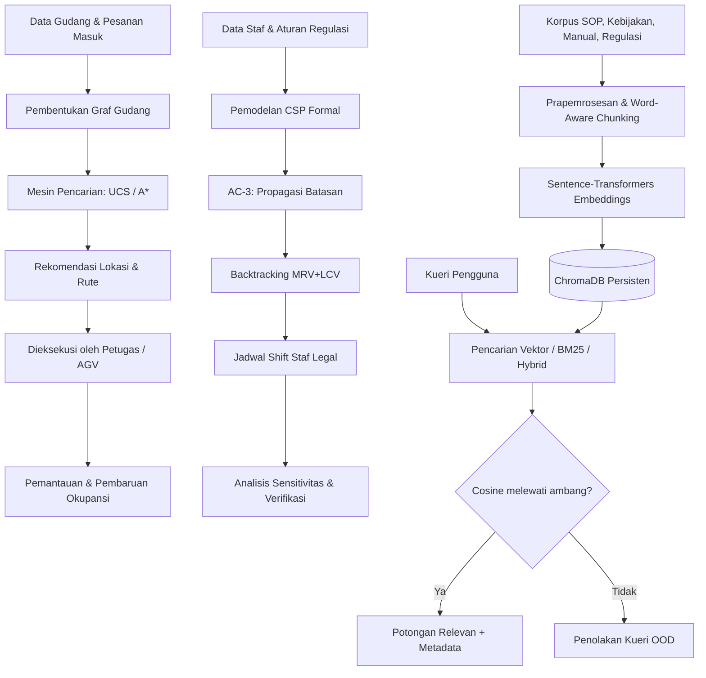
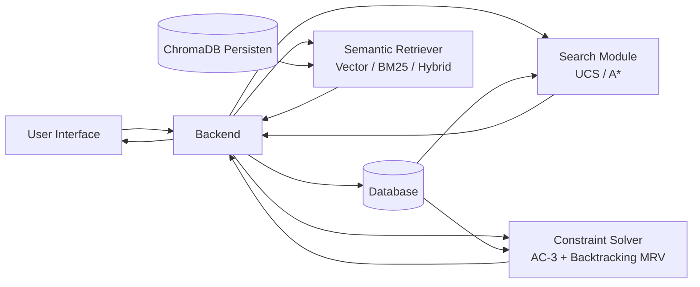

# Smart Warehouse Agent

### Agen Cerdas untuk Optimasi Gudang dan Pencarian Pengetahuan Enterprise

<div align="center">

[](https://www.python.org/)
[](https://docs.astral.sh/uv/)
[](LICENSE)
[](#rencana-pengembangan-roadmap)
[](#rencana-pengembangan-roadmap)

</div>

Smart Warehouse Agent adalah proyek AI mahasiswa yang dikembangkan bertahap selama satu semester. Proyek ini mencakup pencarian rute gudang berbasis graf, penjadwalan shift staf menggunakan CSP, serta basis pengetahuan dokumen enterprise dengan pencarian semantik dan hybrid.

---

## Isi Dokumen

1. [Ringkasan Proyek](#ringkasan-proyek)
2. [Tujuan](#tujuan)
3. [Latar Belakang Masalah](#latar-belakang-masalah)
4. [Pendekatan AI yang Digunakan](#pendekatan-ai-yang-digunakan)
5. [Spesifikasi PEAS](#spesifikasi-peas)
6. [Kemampuan Sistem](#kemampuan-sistem)
7. [Alur Kerja Sistem](#alur-kerja-sistem)
8. [Arsitektur Sistem](#arsitektur-sistem)
9. [Rencana Pengembangan (Roadmap)](#rencana-pengembangan-roadmap)
10. [Struktur Direktori](#struktur-direktori)
11. [Persiapan & Instalasi](#persiapan--instalasi)
12. [Menjalankan Program](#menjalankan-program)
13. [Studi Kasus](#studi-kasus)
14. [Rencana Lanjutan](#rencana-lanjutan)
15. [Anggota Tim](#anggota-tim)
16. [Lisensi](#lisensi)

---

## Ringkasan Proyek

Di banyak gudang, keputusan meletakkan dan mengambil barang masih mengandalkan intuisi staf, bukan perhitungan sistematis atas jarak tempuh, kepadatan lorong, maupun karakteristik barang itu sendiri. Selain itu, penjadwalan shift staf seringkali dilakukan secara manual sehingga rawan melanggar regulasi ketenagakerjaan (batas jam kerja, aturan istirahat antar-shift, ketersediaan staf).

Smart Warehouse Agent menjawab tantangan tersebut melalui tiga modul:

- **Modul Pencarian Graf** — merepresentasikan denah gudang sebagai graf berbobot dan menjalankan UCS/A* untuk menemukan lintasan put-away/retrieval optimal.
- **Modul Constraint Solver** — memodelkan penjadwalan shift staf sebagai CSP (*Constraint Satisfaction Problem*) dan menggunakannya untuk menghasilkan jadwal yang legal, efisien, dan terverifikasi secara matematis.
- **Modul Basis Pengetahuan (Milestone 3)** — mengindeks dokumen SOP, kebijakan, manual, dan regulasi dalam ChromaDB serta menyediakan pencarian semantik dan hybrid dengan penolakan kueri di luar domain.

## Tujuan

- Menekan total jarak/waktu tempuh selama proses put-away maupun picking.
- Mendorong pemanfaatan ruang penyimpanan gudang seoptimal mungkin.
- Menurunkan potensi salah taruh atau salah ambil barang akibat keputusan manual.
- Menghadirkan baseline algoritma pencarian (UCS & A*) sebagai pijakan awal optimasi keputusan penyimpanan dan rute.
- Menghasilkan jadwal shift staf yang memenuhi semua batasan bisnis & regulasi ketenagakerjaan secara otomatis melalui CSP solver.
- Memudahkan pencarian informasi operasional dalam korpus enterprise melalui embeddings, filter metadata, dan evaluasi kueri out-of-domain.
- Membuka ruang pengembangan lanjutan berupa prediksi permintaan dan slotting yang adaptif.

## Latar Belakang Masalah

Beberapa persoalan nyata yang melatarbelakangi proyek ini:

- Rak penyimpanan tidak terisi optimal karena barang kerap ditaruh di slot yang tidak cocok dengan kategori/ukurannya.
- Durasi pengambilan barang (picking time) membengkak sebab barang yang laris (fast-moving) belum tentu berada di titik yang strategis.
- Salah catat lokasi barang memperbesar risiko selisih data stok.
- Penempatan barang masih bersifat reaktif, belum memperhitungkan pola permintaan atau keterkaitan antar-pesanan.
- Sistem manual sulit menyesuaikan diri ketika volume pesanan melonjak, misalnya pada momen promosi besar.
- Penjadwalan shift staf manual rawan melanggar aturan ketenagakerjaan (batas jam kerja, larangan shift malam diikuti shift pagi, kuota staf minimum per shift).
- Informasi operasional tersebar dalam SOP, kebijakan, manual, dan regulasi; pencarian kata kunci sering gagal saat karyawan menggunakan istilah atau sinonim yang berbeda.

## Pendekatan AI yang Digunakan

### Milestone 1 — Pencarian Berbasis Graf (UCS & A*)

Denah gudang diubah menjadi graf berbobot: node mewakili dock, persimpangan lorong, dan slot rak; edge mewakili jarak/waktu tempuh sesungguhnya.

- **UCS** (*Uniform Cost Search*): menjamin lintasan berbiaya minimum dengan f(n) = g(n).
- **A\*** dengan heuristik Manhattan: mempercepat pencarian dengan f(n) = g(n) + h(n) sambil tetap menjamin optimalitas.

### Milestone 2 — Constraint Solver Berbasis CSP

Penjadwalan shift staf dimodelkan sebagai CSP formal:

**Pemodelan Matematis:**

```
Variabel  X = { X_{d,t,k} | d ∈ Days, t ∈ {Morning, Afternoon, Night}, k ∈ {1..slots} }
Domain    D_{d,t,k} ⊆ Staff  (staf yang tersedia pada slot tersebut)
Batasan   C = { C1, C2, C3, C4 }

  C1 (AllDiff/hari)  : ∀ d, ∀ i≠j pada hari d → X_i ≠ X_j
  C2 (Istirahat)     : ∀ s — jika s bekerja NIGHT hari d → s ∉ MORNING hari d+1
  C3 (Kapasitas)     : jumlah slot per shift ∈ [min_cap, max_cap]  (struktural)
  C4 (Batas Jam)     : ∀ s ∈ Staff — Σ jam_kerja(X=s) ≤ max_hours_per_week
```

**Algoritma:**

1. **AC-3** (*Arc Consistency 3*) — propagasi batasan untuk memangkas domain sebelum pencarian.
2. **Backtracking + MRV + LCV + Forward Checking** — pencarian solusi dengan heuristik:
   - MRV (*Minimum Remaining Values*): pilih variabel dengan domain terkecil dahulu.
   - LCV (*Least Constraining Value*): urutkan nilai yang paling sedikit memangkas domain tetangga.
   - Forward Checking: pangkas domain tetangga langsung setelah setiap penugasan.

### Milestone 3 — Basis Pengetahuan dan Vector Semantic Search

Korpus enterprise berisi 18 dokumen SOP, kebijakan, manual, dan regulasi dalam format PDF, Markdown, dan teks. Pipeline membersihkan teks, mempertahankan struktur bab, lalu memotongnya secara word-aware dengan overlap yang selaras kalimat. Sentence-Transformers menghasilkan embedding yang dinormalisasi dan ChromaDB menyimpan vektor secara persisten dengan jarak cosine.

- **Pencarian vektor** — menemukan potongan berdasarkan kemiripan makna.
- **Pencarian hybrid** — menggabungkan peringkat vektor dan BM25 dengan Reciprocal Rank Fusion (RRF), serta mendukung filter metadata.
- **Penolakan out-of-domain** — mengkalibrasi ambang cosine menggunakan kueri dev agar pertanyaan yang tidak didukung korpus dapat ditolak.
- **Evaluasi temu balik** — mengukur Hit@k, MRR, Answer@3, cosine similarity, dan presisi/recall penolakan pada kueri test terpisah.

## Spesifikasi PEAS

| Komponen | Penjabaran pada Smart Warehouse Agent |
| --- | --- |
| **Performance Measure** | Total jarak/waktu tempuh put-away & picking, tingkat pemanfaatan ruang penyimpanan, rata-rata waktu penyelesaian pesanan, tingkat kesalahan penempatan/pengambilan, serta kepatuhan jadwal shift terhadap batasan regulasi ketenagakerjaan. |
| **Environment** | Denah gudang berupa graf rak/lorong, status keterisian tiap slot, atribut SKU (dimensi, berat, kategori, turnover rate), antrean pesanan masuk/keluar, daftar staf & ketersediaannya. |
| **Actuators** | Perintah gerak ke AGV/perangkat genggam petugas, pembaruan status slot pada sistem WMS, instruksi ke conveyor/sorter, pembaruan pick-list digital/label rak, dan penerbitan jadwal shift staf. |
| **Sensors** | Pemindai barcode/RFID, sensor berat & dimensi di dock penerimaan, kamera/computer vision untuk memantau keterisian dan kepadatan lorong, dan feed data real-time dari WMS/ERP. |

## Kemampuan Sistem

- **Pemodelan Graf Gudang** — mengubah denah gudang menjadi graf berbobot lengkap dengan jarak/waktu tempuh antar-titik.
- **Rekomendasi Put-away** — menyarankan lokasi penyimpanan optimal memakai baseline UCS.
- **Optimasi Rute Pengambilan** — menghitung rute pengambilan tercepat memakai A* dengan heuristik Manhattan distance.
- **Perbandingan Biaya & Performa** — membandingkan biaya lintasan serta jumlah node yang dijelajahi antara UCS dan A*.
- **Penjadwalan Shift Staf (CSP)** — menghasilkan jadwal shift yang memenuhi semua batasan regulasi ketenagakerjaan secara otomatis.
- **Analisis Sensitivitas** — menguji kinerja solver pada berbagai skala masalah dan melaporkan waktu konvergensi.
- **Basis Pengetahuan Enterprise (M3)** — memproses dokumen PDF/Markdown/teks menjadi potongan ber-overlap dan mengindeks embedding pada ChromaDB persisten.
- **Pencarian Semantik & Hybrid (M3)** — mencari berdasarkan makna maupun kecocokan istilah, menyaring metadata, dan menolak kueri di luar cakupan korpus.
- **Benchmark Temu Balik (M3)** — membandingkan model dan parameter chunking pada kueri dev, lalu melaporkan evaluasi terpisah pada kueri test.
- *(Lanjutan)* **Kesadaran Slot Stok** — rekomendasi slotting berdasarkan kategori dan turnover barang.
- *(Lanjutan)* **Slotting Berbasis Permintaan** — penyesuaian slotting mengikuti prediksi pola permintaan.

## Alur Kerja Sistem



## Arsitektur Sistem



- **Antarmuka Pengguna** — tempat petugas/pengelola gudang memasukkan data barang, pesanan, dan staf; sekaligus melihat rekomendasi, jadwal shift, dan peringatan.
- **Backend** — menangani validasi input, pembentukan graf gudang, serta komunikasi antar-komponen.
- **Basis Data** — menyimpan data denah gudang, SKU, okupansi rak, histori transaksi, dan data staf.
- **Modul Pencarian/AI** — menjalankan UCS/A* untuk optimasi rute dan lokasi penyimpanan.
- **Modul Constraint Solver** — menjalankan AC-3 + Backtracking MRV untuk penjadwalan shift staf yang legal dan optimal.
- **Pipeline Basis Pengetahuan M3** — memproses korpus enterprise, membuat embeddings dengan Sentence-Transformers, dan menyimpan indeks vektor persisten di ChromaDB.
- **Semantic Retriever M3** — menyediakan pencarian vektor, BM25, hybrid, filter metadata, dan penolakan kueri berdasarkan ambang cosine.

## Rencana Pengembangan (Roadmap)

| Milestone | Fokus Utama | Luaran | Status |
| --- | --- | --- | --- |
| **M1** | Perumusan Masalah & Perencanaan Proyek | Business problem framing, spesifikasi PEAS, formulasi ruang keadaan (X, A, T, G, C), baseline UCS/A*, dan repositori GitHub awal. | ✅ Selesai |
| **M2** | Constraint Solver & Pemodelan Matematis Formal | Pemodelan CSP formal (variabel, domain, batasan C1–C4), implementasi AC-3 + Backtracking MRV+LCV, analisis sensitivitas, dan pengujian otomatis lengkap. | ✅ Selesai |
| **M3** | Basis Pengetahuan Korpus & Vector Semantic Search | Korpus 18 dokumen enterprise, pipeline ingestion dan word-aware chunking, indeks ChromaDB persisten, hybrid search, serta benchmark temu balik dan penolakan kueri out-of-domain. | ✅ Selesai |
| **M4** | Integrasi Sistem & Dashboard | Penggabungan modul pencarian, slotting, constraint solver, penyimpanan data, serta dashboard visualisasi denah gudang. | 🔲 Belum dimulai |
| **M5** | Pengujian, Evaluasi & Presentasi Akhir | Pengujian sistem, evaluasi hasil, pembahasan keterbatasan, dokumentasi, dan presentasi akhir. | 🔲 Belum dimulai |

## Struktur Direktori

```text
smart-warehouse-agent/
├── README.md
├── LICENSE
├── .gitignore
├── pyproject.toml
├── requirements.txt
├── src/
│   ├── kb_pipeline.py          ← M3: CLI ingestion, pencarian, dan benchmark
│   └── kb/                     ← M3: preprocess, chunking, embeddings, vector_store,
│                                  lexical, retriever, ingest, evaluate, benchmark
├── data/
│   ├── raw/corpus/              ← 18 dokumen SOP, kebijakan, manual, regulasi + manifest
│   └── benchmark/queries.json   ← Kueri benchmark dev dan test
├── data/processed/              ← Artefak ingestion dan konfigurasi (dibuat saat pipeline berjalan)
├── data/vectorstore/            ← Indeks ChromaDB persisten (dibuat saat pipeline berjalan)
├── results/benchmark_results.json ← Hasil benchmark (dibuat oleh perintah all)
├── docs/build_report_m3.py      ← Generator laporan teknis PDF M3
├── tests/
│   ├── test_kb_preprocess_chunking.py ← Prapemrosesan dan chunking
│   ├── test_kb_retrieval.py           ← Metrik, retrieval, BM25, dan hybrid
│   └── test_kb_chromadb.py            ← Integrasi ChromaDB persisten
└── pyproject.toml, requirements.txt, uv.lock
```

Folder `data/processed/`, `data/vectorstore/`, dan `results/` berisi keluaran yang dibuat saat pipeline dijalankan; folder tersebut tidak harus sudah tersedia di checkout awal.

## Persiapan & Instalasi

### Yang perlu disiapkan

- Python versi **3.10–3.13**.
- [Astral `uv`](https://docs.astral.sh/uv/getting-started/installation/) sudah terpasang pada `PATH`.
- Git untuk mengambil dan mengelola repository ini.

### Membangun environment

Dari root repository, jalankan:

```bash
uv venv
uv sync
```

Mengaktifkan environment (opsional):

```bash
# Windows PowerShell
.venv\Scripts\Activate.ps1

# Linux/macOS
source .venv/bin/activate
```

Milestone 3 memerlukan `chromadb`, `sentence-transformers`, dan `pypdf`, yang terpasang otomatis lewat `uv sync`. Unduhan pertama model embedding memerlukan koneksi internet.

## Menjalankan Program

### Menjalankan Pengujian Milestone 3

```bash
uv run pytest tests/ -v
```

### Milestone 3: Basis Pengetahuan dan Pencarian Semantik

#### 1. Jalankan benchmark lengkap dan bangun indeks

```bash
uv run python src/kb_pipeline.py all
```

Pada eksekusi pertama, model Sentence-Transformers diunduh sehingga perlu koneksi internet. Perintah ini membandingkan model dan konfigurasi chunking menggunakan kueri dev, mengalibrasi ambang penolakan, membangun indeks ChromaDB persisten, lalu mengevaluasinya pada kueri test. Benchmark mencakup kueri literal, sinonim, ambigu, serta out-of-domain (OOD) dekat dan jauh; data test tidak digunakan untuk memilih konfigurasi.

Artefak yang dihasilkan:

- `data/processed/corpus_clean/`, `chunks.jsonl`, `ingest_report.json`, `kb_config.json`
- `data/vectorstore/` — indeks ChromaDB persisten
- `results/benchmark_results.json` — konfigurasi terpilih dan hasil evaluasi

#### 2. Cari informasi di basis pengetahuan

```bash
# Hybrid (default): menggabungkan pencarian vektor dan BM25
uv run python src/kb_pipeline.py search "suhu ruang beku"

# Pencarian vektor saja
uv run python src/kb_pipeline.py search "aturan suhu" --mode vector

# Batasi hasil dengan metadata dokumen
uv run python src/kb_pipeline.py search "aturan suhu" --kategori "Rantai Dingin"
uv run python src/kb_pipeline.py search "kode E-305" --jenis Manual --mode bm25

# Ubah jumlah hasil yang diminta (default: 3)
uv run python src/kb_pipeline.py search "prosedur barang rusak" -k 5
```

Jalankan `all` setidaknya sekali sebelum pencarian agar indeks dan konfigurasi tersedia. Untuk membangun ulang indeks menggunakan konfigurasi tersimpan tanpa menjalankan benchmark:

```bash
uv run python src/kb_pipeline.py ingest
```

Jika cosine tertinggi di bawah ambang hasil kalibrasi, pencarian menolak kueri sebagai tidak cukup relevan dengan korpus.

Untuk membuat laporan teknis PDF berdasarkan hasil benchmark:

```bash
uv run --extra report python docs/build_report_m3.py --output Grup19-Tugas03.pdf
```

Perintah laporan membaca `results/benchmark_results.json` yang dihasilkan oleh `all`. Tanpa berkas hasil tersebut, laporan akan ditandai sebagai draf.

## Studi Kasus

### Studi Kasus 1 — Optimasi Rute Pengambilan (M1)

Misalkan Gudang Nusantara Logistik baru saja menerima kiriman barang:

1. Barang tiba di dock penerimaan dan atributnya dicatat (dimensi, berat, kategori);
2. Sistem membentuk graf gudang berdasarkan denah lorong dan rak yang berlaku saat ini;
3. Algoritma UCS/A* mencari lintasan berbiaya (jarak/waktu) paling rendah dari dock menuju slot rak tujuan;
4. Sistem memberikan rekomendasi lokasi penyimpanan dan/atau rute pengambilan yang optimal; dan
5. Petugas atau AGV menjalankan instruksi actuator untuk menuntaskan proses put-away maupun picking.

### Studi Kasus 2 — Penjadwalan Shift Staf (M2)

Misalkan Gudang Nusantara Logistik perlu menyusun jadwal shift 5 staf untuk 5 hari kerja:

1. Manajer memasukkan daftar staf, ketersediaan, dan aturan regulasi (maks. 40 jam/minggu, larangan shift malam→pagi berturutan);
2. Sistem memodelkan masalah sebagai CSP formal (variabel, domain, batasan C1–C4);
3. AC-3 memangkas domain yang tidak konsisten sebelum pencarian dimulai;
4. Backtracking MRV+LCV menemukan jadwal shift yang memenuhi semua batasan;
5. Sistem memverifikasi setiap batasan dan menampilkan jadwal akhir yang siap dieksekusi.

## Rencana Lanjutan

Beberapa arah pengembangan berikut masih terbuka untuk dipertimbangkan:

- Menghadirkan model prediksi permintaan (demand forecasting) untuk slotting yang adaptif;
- Mengembangkan koordinasi multi-agent bagi beberapa AGV/petugas sekaligus;
- Menambahkan penalti kongesti yang dinamis pada fungsi biaya (cost function);
- Membangun dashboard visual untuk denah gudang dan status okupansi rak; dan
- Menguji algoritma pencarian pada graf gudang berskala jauh lebih besar dan kompleks.

Daftar di atas adalah kemungkinan arah pengembangan, bukan klaim bahwa fitur tersebut sudah tersedia atau bersifat final.

## Anggota Tim

| Nama | NIM | Peran M1 | Peran M2 | Peran M3 |
| --- | --- | --- | --- | --- |
| Nicolas J Grace Butarbutar | 12S24038 | Search Algorithm Engineer & Repository Maintainer | CSP Solver Developer (AC-3, Backtracking MRV+LCV, Forward Checking) & Repository Maintainer | Pipeline Engineer & Repository Maintainer (Modul embedding, ChromaDB, retriever, CLI, rilis) |
| Indah Triyuni Siahaan | 12S24052 | Business Analyst & Requirements / Problem Framing | CSP Domain Modeler (Pemodelan Matematis Formal: variabel, domain, batasan C1–C4) & Business Rules Analyst | Corpus & Domain Analyst (Korpus dokumen enterprise, verifikasi proses bisnis, penyusunan kueri uji) |
| Swasti Maristella Sihombing | 12S24030 | PEAS, Testing & System Documentation Specialist | Testing Specialist (Unit Tests, Edge Cases, Sensitivity Analysis) & System Documentation | Evaluation & Documentation Specialist (Benchmark temu balik, pengujian, analisis hasil, laporan teknis) |

## Lisensi

Repositori ini dilisensikan di bawah **MIT License**. Ketentuan selengkapnya dapat dilihat pada berkas [LICENSE](LICENSE).

---

*Disusun untuk memenuhi rangkaian proyek terpadu mata kuliah **10S3001 - Kecerdasan Buatan**, Program Studi Sarjana Sistem Informasi, Institut Teknologi Del, Semester Gasal 2026/2027, di bawah bimbingan dosen pengampu **Samuel Indra Gunawan Situmeang**.*
